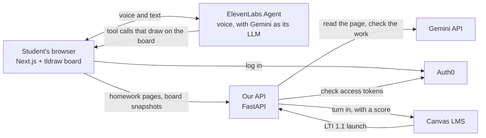

# Learning Grounds

**A voice tutor that works through your real homework with you, on a shared whiteboard.**

Upload a homework PDF and pick a tutor. Talk or type, and the tutor talks the problem through with you while it draws on your page. It circles the problem, underlines the facts that matter, writes a hint in math, sketches a graph, or writes a question for you to answer. When you've worked a step, ask it to check your work, and it reads your handwriting.

**Try it:** https://learningrounds.com (log in with Google or an email address)

Built at [SharkByte 2026](https://sharkbyte2026.devpost.com/) by Lorenzo ([LorenzoBLA](https://github.com/LorenzoBLA)) and Aquiles ([aquilesalcacio](https://github.com/aquilesalcacio)).

## Why we built it

- Problem solving is visual and spoken, but chat tutors can't point at anything on your page.
- AI that hands out answers can make exam results worse. A good tutor guides you to the answer.
- Human tutors are expensive, and they aren't around at 11 PM.
- Students who think in Portuguese or Spanish get less help in the language they think in.

## What it does

- **Reads your homework.** Upload a PDF. Gemini reads each page and finds where every problem is, so the tutor can point at problem 3 on your actual page.
- **Talks and draws at the same time.** Speak or type. The tutor answers by voice and marks up the board as it talks. It points, circles, underlines, highlights and draws arrows. It writes text and math, and draws number lines, graphs and labelled shapes.
- **Asks you questions.** The tutor writes practice questions on the board with an answer box, then reads what you wrote in it.
- **Guides instead of answering.** Every tutor has a locked core prompt: coach the next step, and never give a final answer before you've tried. Students can read it but not edit it. Prompts can't guarantee behavior, so a determined student could still dig out an answer.
- **Checks your work.** Gemini reads a snapshot of your handwriting on the board. The tutor then tells you, in its own voice, what's right and where a step went wrong.
- **Tutors you design.** Three are ready to go: Prof. Sam (English, humorous), Prof. Luisa (Portuguese, casual) and Prof. Erik (Spanish, formal). Or make your own, with a name, color, voice, language, tone and teaching style.
- **Works with Canvas LMS.** Open Learning Grounds from a Canvas course menu, and it fills in your Student Profile. Add your Canvas calendar feed to bring in your courses and due dates, so the tutor knows what's coming up. On a graded assignment, **Turn in** sends your session back to Canvas as your submission.

## How it works



1. **Login.** Auth0 guards every page. The browser never holds the ElevenLabs key or the agent ID: once a student is logged in, the browser asks our API for a one-time session credential (`POST /voice/session`) and connects to the agent with it.
2. **Reading the homework.** pdf.js renders each page to an image. `POST /documents/read-page` sends it to Gemini, which transcribes the page and returns a box around each problem. The app turns those boxes into regions such as `p1.q3`, the targets for the tutor's tools.
3. **Talking and drawing.** The ElevenLabs agent runs the conversation, with Gemini 3.8 Flash as its LLM. Its 15 client tools run in the browser and draw on the tldraw board in the tutor's handwriting and color: `focus_region`, `point_at`, `circle_region`, `underline_region`, `highlight_region`, `draw_arrow`, `write_text`, `write_math` (rendered with KaTeX), `number_line`, `plot_graph`, `draw_shape`, `ask_question`, `read_student_work`, `get_student_progress` and `clear`. They're defined in [api/voice/tools.json](api/voice/tools.json).
4. **Checking work.** The board takes a snapshot of the student's work and sends it to `POST /check-work`. Gemini reads it, and the result goes to the tutor, who answers in its own voice.
5. **Canvas LMS.** Learning Grounds is an LTI 1.1 app ([api/canvas_lms_lti.py](api/canvas_lms_lti.py)). Turn in uses LTI Basic Outcomes ([api/canvas_lms_grades.py](api/canvas_lms_grades.py)). Our API decides the score, never the browser: full points for completion, and any grade the teacher gives takes priority.

## Gemini and Auth0

**Gemini** does three jobs:
- It's the LLM inside the ElevenLabs voice agent ([api/scripts/elevenlabs_setup.py](api/scripts/elevenlabs_setup.py)).
- It reads each homework page and finds the problems ([api/read_page.py](api/read_page.py)).
- It reads the student's handwriting to check their work ([api/check_work.py](api/check_work.py)).

**Auth0** handles all login and API access:
- Universal Login (Google or email) protects every page, through the Auth0 Next.js SDK ([web/proxy.ts](web/proxy.ts)).
- The API checks an RS256 Auth0 access token on every request ([api/auth.py](api/auth.py)).
- Only a logged-in student can get a voice session, and Canvas LMS launches and turn-ins are stored under the student's Auth0 user ID.

## Built with

| Part | Built with |
|---|---|
| Web app ([web/](web/)) | Next.js 16, React 19, TypeScript, Tailwind CSS, shadcn/ui, tldraw, KaTeX, pdf.js, ElevenLabs React SDK, Auth0 Next.js SDK |
| API ([api/](api/)) | Python, FastAPI, Gemini (google-genai), Auth0 tokens (PyJWT), pypdfium2, Pillow |
| Voice | ElevenLabs Agents, with Gemini 3.8 Flash as the LLM |
| Canvas LMS | LTI 1.1 launch and Basic Outcomes |
| Hosting ([deploy/](deploy/)) | Docker Compose and nginx on a Hostinger VPS, with Let's Encrypt certificates |

## Run it locally

1. Copy the example settings, then fill in your own keys (Auth0, ElevenLabs, Gemini):
   ```bash
   cp api/.env.example api/.env
   cp web/.env.example web/.env.local
   ```
2. Start the API:
   ```bash
   cd api && uv run uvicorn main:app --reload --port 8000
   ```
3. In a second terminal, start the web app, then open http://localhost:3000:
   ```bash
   cd web && npm install && npm run dev
   ```

`api/scripts/elevenlabs_setup.py` creates the ElevenLabs agent with its tools.

**Tests:** `cd api && uv run pytest`, and `cd web && node --test lib/*.test.ts`.

## What's where

- [web/](web/): the Next.js app. The board, the tutor's pen and its tools are in `web/lib/lg-*.ts`. The tutor prompt is in [web/lib/lg-tutor-prompt.ts](web/lib/lg-tutor-prompt.ts).
- [api/](api/): the FastAPI app, with tests in `api/tests/`. `api/scripts/` sets up the ElevenLabs agent and seeds a Canvas LMS test course.
- [deploy/](deploy/): Docker Compose, the nginx sites, and the timer that deploys new versions of the live site.

## Credits

- Libraries and services: tldraw, Next.js, React, Tailwind CSS, shadcn/ui, KaTeX, pdf.js, FastAPI, google-genai, pypdfium2, Pillow, ElevenLabs Agents and Auth0.
- The tutor orb ([web/components/tutor-orb.tsx](web/components/tutor-orb.tsx)) is adapted from the 21st.dev Siri orb.
- We used AI coding assistants, including Claude Code, while building.
- The project started at SharkByte on November 6, 2026. The commit history shows the weekend's work.
